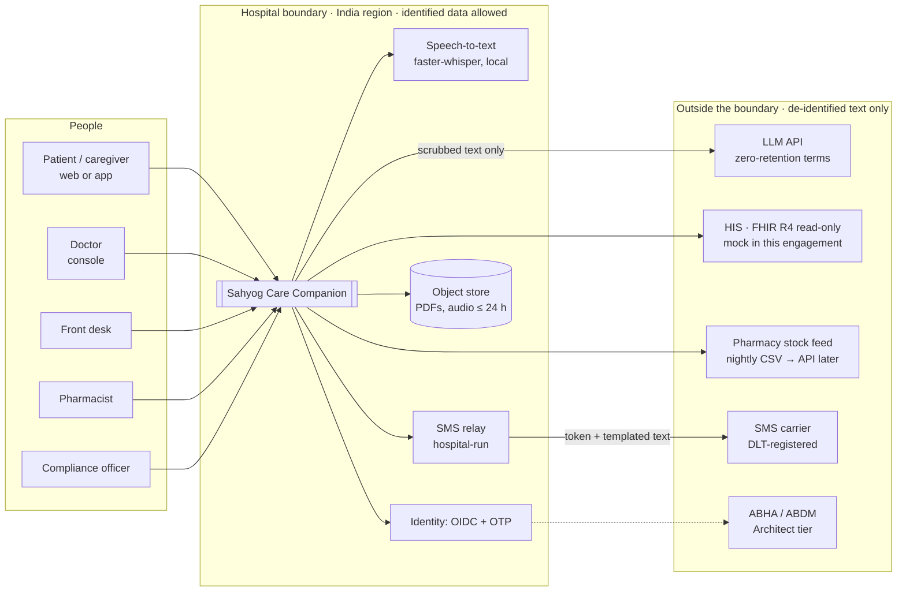
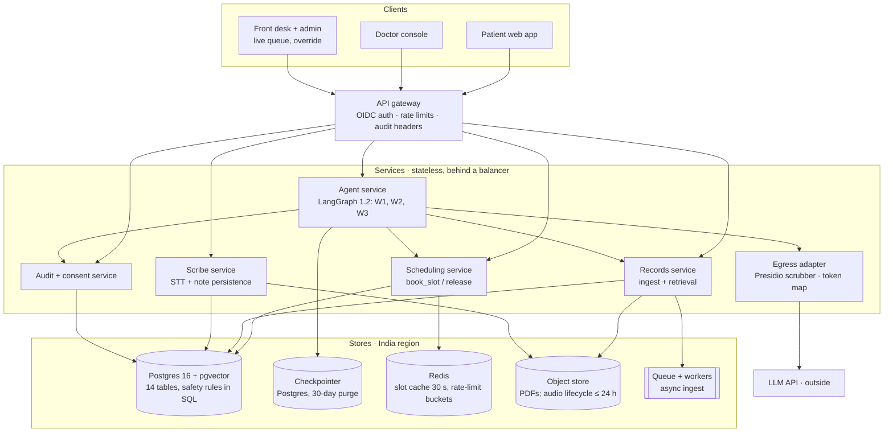
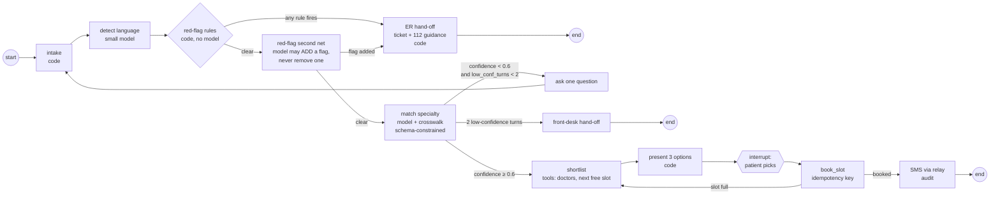

# Architecture pack — v1 (day 5)

**Status:** v1 · 2026-11-02 · owner: pod lead
**Scope at v1 (deck p.41):** context view, container view, W1 graph, ADRs 1–3. The W2 and W3 graphs and the two sequence diagrams follow at v2, before their code.

The pack's diagrams are the delivery office's opening view. The deck says they are to be **corrected and re-issued**, and copying them uncorrected loses marks (p.49). §4 lists every correction and the reason for each.

Diagrams are Mermaid; they render in VS Code (Markdown preview) and on GitHub.

---

## 1. Context view

Who touches the system, and what it depends on. Arrows follow the direction of the request.

## 2. Container view

**The rule the CIO is owed (deck p.7):** the agent service never calls the LLM directly. Every model call goes through the egress adapter, which scrubs the text, keeps the token map in-region and logs the outbound payload's hash. This is also where the vendor is swapped, without any graph change (E6-2).

## 3. W1 graph — Find my doctor

State: `messages, patient_id (from auth, never from the model), age, language, symptoms, red_flags[], specialty, alternative, confidence, low_conf_turns, candidates[], chosen_slot, booking_id, audit_ids[]`.

Node rules that are code, not prompts:

| Node | Rule | Where it is enforced |
|---|---|---|
| red-flag rules | Runs before any model call and cannot be overridden | Graph edge order plus the `w1-redflag-*` eval cases |
| second net | Output is a set union with the rules' flags, so it can only add | Code merges the two sets; a test covers it |
| match | Output must be one of the 38 specialty ids; anything else counts as low confidence | Pydantic schema on the model output |
| book | Double-booking is impossible | `book_slot()` and the `CHECK (booked <= capacity)` constraint |
| every node | `patient_id` comes from the auth context in state, never from model text | Tool signatures take it from state only |

## 4. Corrections to the pack's diagrams

| # | Pack page | What the pack shows | What we changed | Why |
|---|---|---|---|---|
| 1 | p.23 vs p.6 | The container view puts 3 systems outside the boundary, but the context view lists 7 dependencies | All dependencies are drawn and each is placed inside or outside the boundary | A boundary you can't see is the CIO's first question (p.7) |
| 2 | p.6 | The SMS gateway is drawn outside, yet it receives a phone number, which is a direct identifier that "never" leaves (p.21) | A hospital-run SMS relay inside the boundary; the carrier receives a token plus templated text, or the number only under a DLT contract (D3 A08) | The pack's own data classes contradict its context view |
| 3 | p.6, p.23 | Speech-to-text placement is ambiguous | STT sits inside the boundary (faster-whisper, local); a hosted STT only in-region under contract (D3 A11) | Audio is identified data |
| 4 | p.23 vs p.31 | Redis appears in the memory table but not in the container view | Redis added, for the slot cache and the rate-limit buckets | The diagrams must agree |
| 5 | p.27 vs p.28 | W3 checks stock before review, but the doctor picks the molecule during review | W3 v2 re-runs the stock check after the doctor's edit and before persistence | Otherwise the flag describes a medicine the doctor didn't choose |
| 6 | p.25 | The W1 red-flag check reads "rules first, LLM second", but the drawing shows one node | Two nodes: deterministic rules, then a model net that can only add flags | Makes "the model can never clear a red flag" visible and testable |
| 7 | p.19 vs p.20 | A "1,400-doctor split" against 500 generated doctors | 500 throughout | 500 × 60 × 16 = 480,000 matches p.20 and p.22 |
| 8 | p.22 | Checkpoints are "tens of MB a day" | ~150–300 MB a day, with a 30-day purge job | Arithmetic in docs/d5-sizing.md |
| 9 | p.18 | DocChunk has no patient_id | patient_id on every chunk, plus a composite FK to document | The retrieval filter becomes a plain WHERE that can't disagree with its parent (ADR-002) |
| 10 | p.18 | ClinicalNote stores drafts and signed notes alike | Only signed notes are stored; drafts live in the checkpointer; signed notes are immutable and versioned | "An unsigned note is a draft by schema" (p.5) |

## 5. Decisions
- [ADR-001](adr/ADR-001-hybrid-deployment.md): hybrid deployment, with identified data in-region and only de-identified text crossing the boundary
- [ADR-002](adr/ADR-002-safety-rules-in-the-database.md): safety rules live in the database, not in prompts
- [ADR-003](adr/ADR-003-w1-graph-shape.md): W1 is a LangGraph graph with rules-first red flags and an interrupt for the slot pick

## 6. Open at v1
- The W2 and W3 graphs and the two sequence diagrams (v2, before day 8)
- Checkpoint purge job and audio lifecycle job (day 7)
- Every item depending on the D2 answers: A07 vendor terms, A08 SMS, A10 appointment-book ownership
