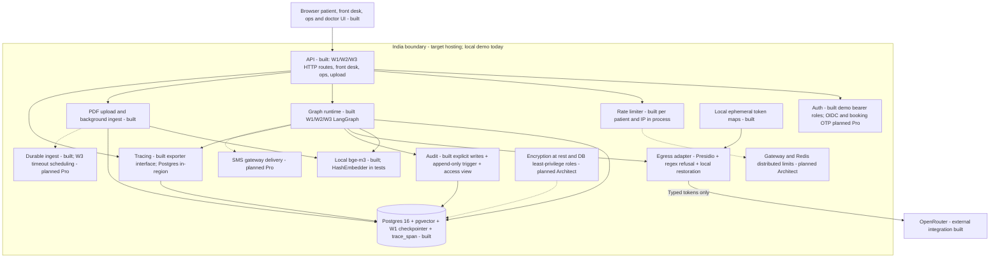

# Containers — C4 level 2

These are logical components, not separately deployed microservices. Core uses one synchronous API
process and a shared lock. Sources: `services/api/{main,deps,auth,ratelimit}.py`,
`services/agent/llm.py`, `services/records/{embed,ingest,retrieve}.py`, `infra/docker-compose.yml`.

Only W1 is wired to `PostgresSaver` in the production factory; W2 is request-scoped without a
checkpointer. Traces contain no prompt/question/symptom text or patient ID; audit events provide
the trace-to-patient mapping. The exporter interface permits a future self-hosted Langfuse exporter;
Langfuse Cloud is rejected for residency. Uploads are local files, not a built object store. Audit is
not an automatic database read interceptor. Planned tier allocations here and in D7 are delivery
targets, not implemented guarantees.

The adapter uses pinned local en_core_web_sm and custom Indian recognisers for W1/W2/W3, including hedges. Maps never leave process memory; replies restore locally. Migration 011 stores numeric deid_ms only. Replay egress-20261103-010825 reports zero hits in 200 synthetic payloads; statistical names/quasi-identifiers remain residual risks.
