# Containers — C4 level 2

The app profile runs one API; the scale profile configures two API replicas behind
Nginx. Durable PDF ingestion runs in a separate worker process with the same image.
Sources: `services/api/{main,deps,auth,ratelimit}.py`,
`services/mcp/server.py`, `services/agent/llm.py`, `services/records/{embed,ingest,retrieve}.py`,
`infra/docker-compose.yml`.

```mermaid
flowchart TB
    UI[Browser patient, front desk, ops and doctor UI - built] --> API
    AGENT[Approved hospital agent] --> MCP
    subgraph India[India boundary - target hosting; local demo today]
        API[API - built: W1/W2/W3 HTTP routes, front desk, ops, upload]
        LB[Nginx scale profile: REST round robin, MCP ip_hash]
        API2[API replica 2 - scale profile]
        MCP[MCP - built: Streamable HTTP at /mcp, sticky in scale profile]
        AUTH[Auth - built demo bearer roles; OIDC and booking OTP planned Pro]
        RL[Rate limiter - built per patient and IP in Postgres]
        GRAPH[Graph runtime - built W1/W2/W3 LangGraph]
        STOCK[W3 stock adapter - built]
        PG[(Postgres 16 + pgvector + shared checkpoints, rate buckets, replay state and trace spans)]
        EMB[Local bge-m3 - built; HashEmbedder in tests]
        ING[PDF upload - enqueue and owner-only job status]
        EG[Egress adapter - Presidio + regex refusal + local restoration]
        AUD[Audit - built explicit writes + append-only trigger + access view]
        TRACE[Tracing - built exporter interface; Postgres in-region]
        PHI[Local ephemeral token maps - built]
        QUEUE[Postgres ingest_job queue - built]
        WORKER[Ingest worker - batch claim; 3 attempts; crash recovery]
        IGRAPH[Records ingest graph - bounded Send pool and join]
        CRYPTO[Encryption at rest and DB least-privilege roles - planned Architect]
        SMS[SMS gateway delivery - planned Pro]
        API --> AUTH
        API --> RL
        API2 --> AUTH
        API2 --> RL
        LB --> API
        LB --> API2
        API --> GRAPH
        API --> ING
        MCP --> AUTH
        MCP --> RL
        MCP --> PG
        MCP --> STOCK
        MCP --> AUD
        MCP --> TRACE
        WORKER --> IGRAPH
        IGRAPH --> EMB
        IGRAPH --> PG
        IGRAPH --> TRACE
        ING --> PG
        GRAPH --> PG
        GRAPH --> EMB
        GRAPH --> EG
        GRAPH --> AUD
        GRAPH --> STOCK
        API --> TRACE
        API2 --> TRACE
        GRAPH --> TRACE
        TRACE --> PG
        AUD --> PG
        PHI --> EG
        ING --> QUEUE
        QUEUE --> PG
        WORKER --> QUEUE
        CRYPTO -.-> PG
        GRAPH -.-> SMS
    end
    EG -->|Typed tokens only| OR[OpenRouter - external integration built]
```

W1 and W3 use `PostgresSaver` in the production factory; W2 is request-scoped without a
checkpointer. Migration 014 stores shared hashed rate buckets and leased replay claims.
MCP session state remains process-local, so Nginx pins `/mcp/` by source IP; ordinary REST
traffic is round-robin. The model circuit breaker and per-trace model-call semaphore are
process-local availability/concurrency controls, not workflow state. Traces contain no prompt/question/symptom text or patient ID; audit events provide
the trace-to-patient mapping. The exporter interface permits a future self-hosted Langfuse exporter;
Langfuse Cloud is rejected for residency. Uploads are local files, not a built object store. Audit is
not an automatic database read interceptor. Planned tier allocations here and in D7 are delivery
targets, not implemented guarantees.

Migration 012 adds owner-scoped, content-hash-idempotent document jobs. Migration 013
extends the audit actor-role constraint for MCP ops calls; migration 014 adds
cross-replica API controls. The API
commits document registration and enqueue together and returns HTTP 202. Workers
claim using `FOR UPDATE SKIP LOCKED`; session advisory locks fence live attempts
and disappear on disconnect. Retry eligibility is persisted with exponential
backoff. Indexed documents survive a crash before job completion without another
ingest. Compose shares upload files between API and worker; W3 timeout scheduling
remains planned. Ops queue metrics read `ingest_job` and omit an empty table.

The worker claims up to `INGEST_BATCH_SIZE` jobs, default 8, and fans them out through
the independent records graph at `INGEST_MAX_CONCURRENCY`, default 4. Every batch has
one parent trace and one child span per document; failures and retry backoff are scoped
to the failed job. The graph joins before completion updates and does not change W2.
See [bounded ingest fan-out](ingest-fanout.md).

The adapter uses pinned local en_core_web_sm and custom Indian recognisers for W1/W2/W3, including hedges. Maps never leave process memory; replies restore locally. Migration 011 stores numeric deid_ms only. Replay [egress-20261103-051910](../../evals/runs/egress-20261103-051910.json) reports 0 hits in 200 synthetic payloads with p95 14.296 ms; statistical names/quasi-identifiers remain residual risks.
