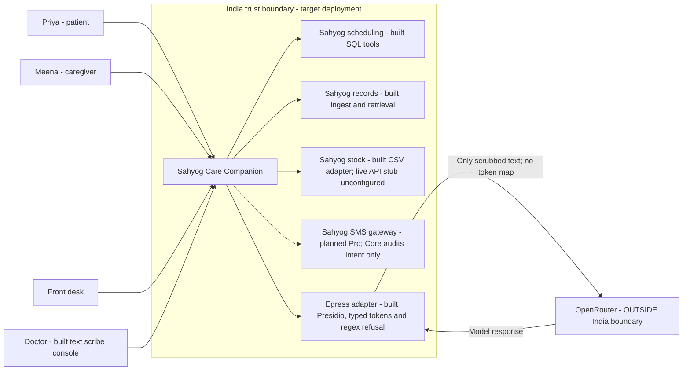

# Context — C4 level 1

Built interactions: `services/api/main.py`, `services/agent/store.py`, `services/agent/w2/tools.py`.
Boundary is the target in [D6](../../infra/deployment-adr.md), not evidence of deployed India hosting.

Meena's records access requires current, scoped consent. The egress arrow states the intended contract:
statistical recognition retains risks for unfamiliar names and quasi-identifiers; see [D7](../d7-threat-model.md).
No external HIS, live pharmacy feed, SMS delivery is claimed as built.
