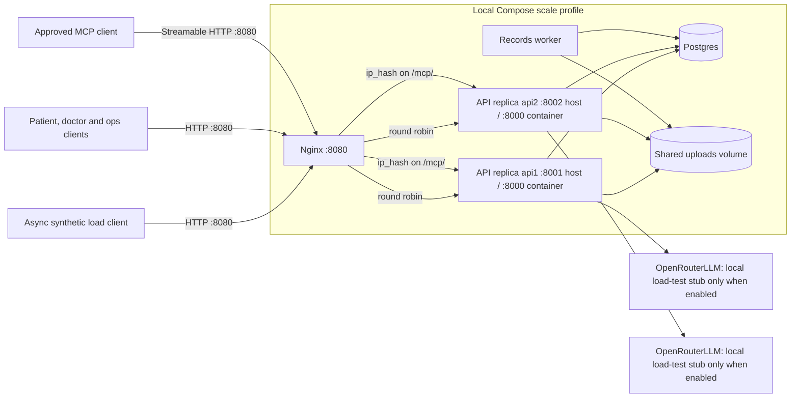

# Scale deployment

The `scale` Compose profile configures two API instances on host ports 8001 and
8002 behind Nginx on 8080. The ordinary HTTP pool is round-robin; the MCP path
is sticky by source IP because the SDK keeps Streamable HTTP sessions in process
memory. Load tests use ordinary API routes through Nginx to observe both replica
IDs.

Postgres stores W1/W3 checkpoints, bookings, request reservations, shared
rate-limit buckets, W1 resume/upload replay results and trace spans. The worker
claims queued uploads from Postgres and uses the shared volume. MCP transport
session state is the deliberate exception: Nginx keeps a client source IP on one
API replica. Reconnect and initialize a new MCP session after an IP or replica
change. Stub mode does not bypass red-flag rules, de-identification, W2 SQL
retrieval, database access or tracing.

The API host-port mappings are diagnostic direct-access ports; load tests should
target Nginx at `http://127.0.0.1:8080` so each request is balanced across both
replicas.

The Compose file supplies topology and config only; this diagram does not claim
that images were built or that the 1,400 requests/hour p95 targets passed. See
[ADR-007](../adr/ADR-007-scaling-and-load.md) and generated
[`evals/report.md`](../../evals/report.md) for measured status.
