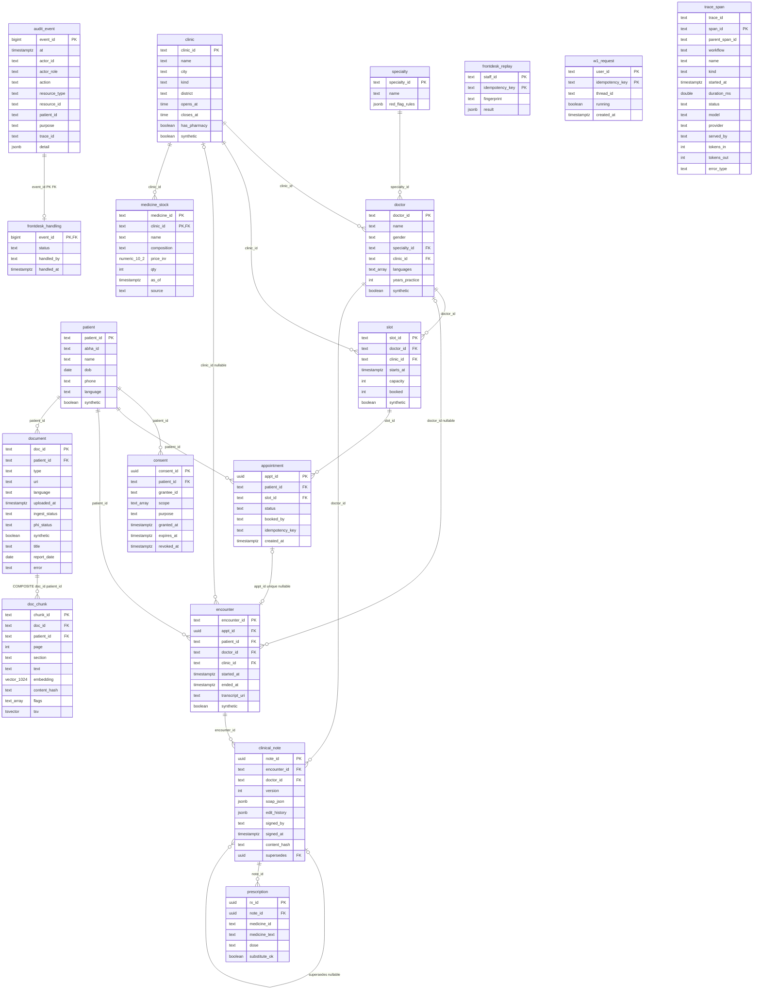

# Entity model — migrations 001–007

Derived from the checked-in SQL, including all 18 persistent application tables and columns.
Migration 002 uses temporary staging tables `_clinic` and `_spec` for loading; these are not persistent entities.
Migration 003 replaces a trigger function; 004 adds document/chunk columns and indexes; 005–006 add three tables;
007 adds the PHI-free `trace_span` table and audit trace-context trigger.
LangGraph creates its own checkpoint tables through `PostgresSaver.setup()`; those are outside migrations 001–007.

## Database-enforced rules

- CHECKs restrict clinic city/kind/opening times; doctor gender, languages and practice years; consent scopes, expiry and distinct grantee; slot capacity/booked range; appointment status/booked_by; encounter time order; note version/SOAP keys/signer/supersedes; stock nonnegative price/quantity and source; document type/ingest/PHI status; chunk page; audit actor role/action; handling status.
- `book_slot` returns an existing appointment for `(patient_id,idempotency_key)`; otherwise it atomically increments available capacity and inserts. Appointment has that unique pair and a partial unique index on live `(patient_id,slot_id)`. `release_appointment` releases the seat transactionally.
- Only signed notes can be inserted. The hash trigger computes SHA-256 of SOAP JSON; update/delete are refused. `(encounter_id,version)` is unique. `signed_by = doctor_id` checks the note row, not authenticated identity or equality with the encounter doctor.
- `doc_chunk(doc_id,patient_id)` references `document(doc_id,patient_id)` with cascade delete; the parent pair is UNIQUE. This is one composite FK, not an independent chunk-to-patient FK.
- Audit update/delete are refused; `who_saw_record` projects patient-associated read events. Application code must still write the events. Privileged owners can bypass triggers; TRUNCATE is not covered.
- Migration 005 separates handling and replay state from immutable audit rows; 006 uses `(user_id,idempotency_key)` PK and unique `thread_id`. Neither table declares an FK from user/staff identifiers to patient.
- Migration 007 stores spans without prompt, question, symptom or patient text/IDs; audit `trace_id` is the correlation path. `purge_trace_spans()` removes rows older than 30 days and must be scheduled by operations.
- No FK exists for `prescription.medicine_id` (stock key is composite), audit patient/actor IDs, consent grantee, note `signed_by`, or handling staff. These are deliberately not drawn as relationships.

Sources: [001](../../infra/db/001_schema.sql), [002](../../infra/db/002_load_generated.sql), [003](../../infra/db/003_fix_forbid_change_errcode.sql), [004](../../infra/db/004_w2_records.sql), [005](../../infra/db/005_frontdesk.sql), [006](../../infra/db/006_w1_requests.sql), [007](../../infra/db/007_tracing.sql).
