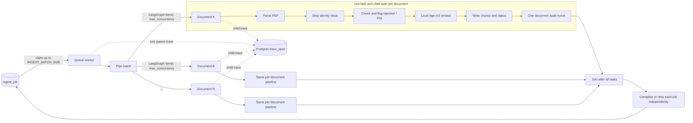

# Bounded document-ingest fan-out

The queue worker claims a bounded batch with `FOR UPDATE SKIP LOCKED`, then invokes
the records ingest graph under one trace. Each `Send` task owns one PDF and one child
span. A per-document failure is recorded and retried without cancelling sibling tasks.
The join waits for every document before the worker marks each job done or schedules
its own retry. The W2 answer graph is unchanged.

`INGEST_MAX_CONCURRENCY` defaults to 4; `INGEST_BATCH_SIZE` defaults to 8. The local
embedding model is loaded once by the worker process and shared across its graph tasks.
PDF content hashes make completed ingestion idempotent.
