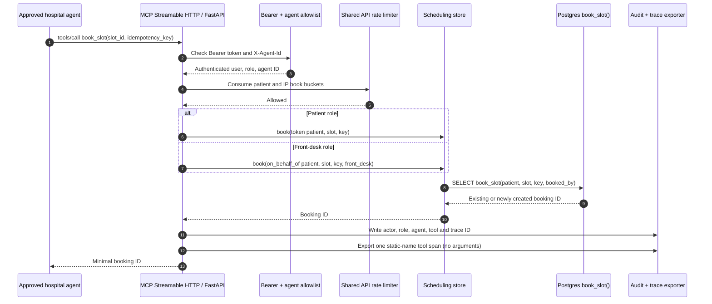

# MCP booking sequence

The patient actor comes from the bearer token. A front-desk booking for another patient
requires explicit `on_behalf_of` and records both staff actor and patient in the audit
event. A failed authorization or unapproved agent is denied and audited.
