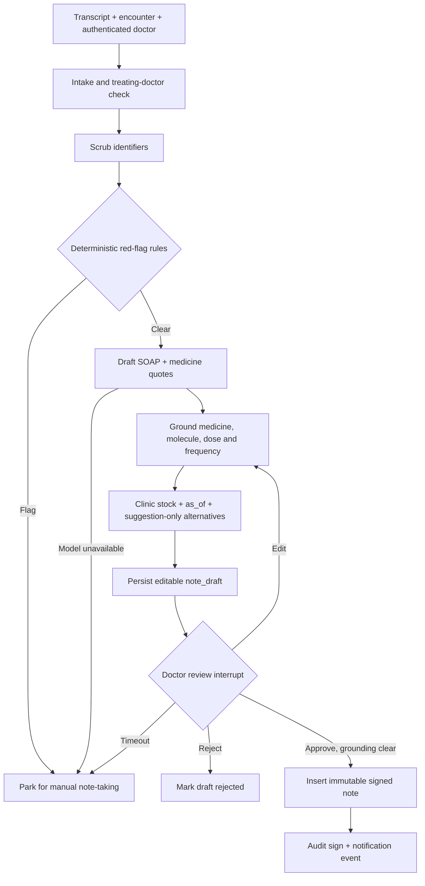

# W3 scribe — Pro workflow

The W3 graph drafts an unsigned note, checks every medicine against quoted dictation, and pauses
for the treating doctor. The service accepts `doctor_id` only from its authenticated caller; it
does not accept patient identity from the transcript or model. The doctor-facing API/console and
the scheduled timeout runner are not wired into the demo API.

Edits are recorded in `note_edit` and loop through grounding and stock again. An out-of-stock
warning is visible to the doctor but does not substitute a medicine or prevent signing. Unresolved
grounding flags block approval until edited. The database binds the signer to the encounter's
treating doctor; the existing trigger hashes `soap_json` and rejects later note updates/deletes.
Subsequent signed versions link to the prior note with `supersedes`.

`W3_REVIEW_TIMEOUT_MIN` controls review expiry. A resumed expired review is parked by the graph;
schedule `python -m services.agent.w3.timeout_worker` periodically to park reviews while no doctor
is resuming a checkpoint. The demo API does not start this worker. Notification is currently an
audited event, not carrier delivery.

`data/synthetic/generate_dictations.py` writes 300 seeded dictations under ignored
`data/synthetic/out/w3/` and refreshes the 40 fixed fixtures in `evals/fixtures/w3/`.
`data/synthetic/generate_stock.py` writes one nightly CSV per clinic from the medicines transform.
