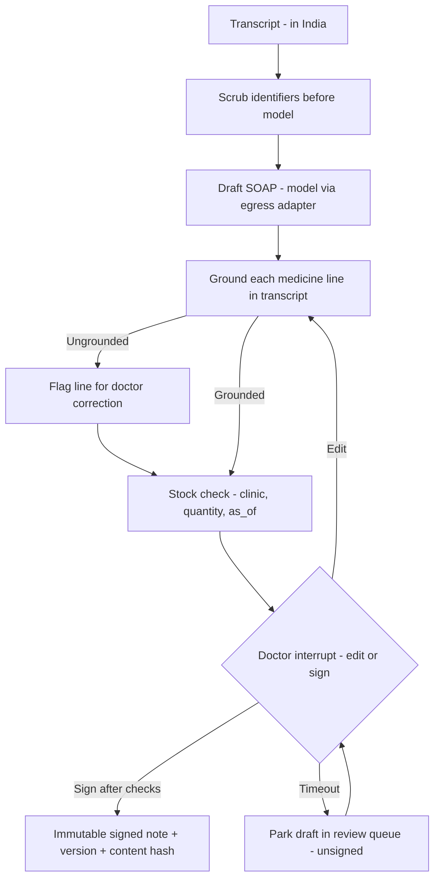

# W3 scribe — DESIGN, Pro tier, not built

The note schema exists in migration 001; there is no W3 runtime, doctor console, grounding checker,
stock integration, timeout worker or review queue. This is the proposed workflow, not an exported graph.

An edit re-runs grounding and stock checks so the stock status describes the final medicine.
The database computes a SHA-256 hash of SOAP JSON, requires signature fields, and rejects update/delete;
it does not implement the doctor interrupt or authenticate the signer. Later edits create a new version.
