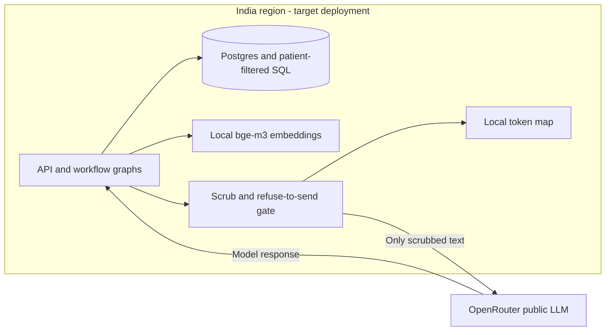

# D6: Deployment boundary

The decision is **hybrid**, following [ADR-001](../docs/adr/ADR-001-hybrid-deployment.md), the proposed decision record. Identified data belongs in an India region; only scrubbed text may cross the LLM boundary. This is the target architecture, not a claim that the local demo is hosted in India.

## Options

Scores: 1 = least favourable, 5 = most favourable. Operations scores reward lower burden; cost scores reward flexibility at Core scale, not a measured price estimate.

| Option | Identified-data residency | Access to current models | Operations burden | Cost shape |
| --- | --- | --- | --- | --- |
| On-premise, local models | 5: full local control | 2: constrained by purchased hardware | 1: hospital operates hardware and GPUs | 2: high fixed procurement and staffing |
| Private cloud, India region, local models | 5: regional stores and inference | 3: models depend on available GPUs | 3: managed infrastructure, inference still operated | 3: recurring provisioned GPU capacity |
| Public cloud + public LLM, identified prompts | 1: identified data reaches public vendor; rejected | 5: current hosted models | 5: low infrastructure burden | 4: usage based, grows with calls |
| Hybrid | 5: identified processing in-region, conditional on scrub boundary | 5: current models through adapter | 3: regional estate plus egress controls | 4: regional baseline plus variable LLM calls |

## Egress boundary

The token map stays local. No map, identified record store, or embedding service is sent to OpenRouter. ADR-001 also defines revisit triggers: degraded W3 draft quality, an India-region vendor endpoint with suitable terms, or identifiers found during replay. A replay leak must stop egress until fixed.

## Built today vs not yet

Built today: Presidio AnalyzerEngine with pinned local spaCy en_core_web_sm and custom Indian recognisers in `services/common/deid.py`; system and user messages scrubbed for every W1/W2/W3 primary and hedge; typed ephemeral in-process token maps; recursive reply restoration before display; original regex plus expanded refuse-to-send guard. Migration 011 adds numeric-only `deid_ms` to model spans. Offline replay [egress-20261103-010825](../evals/runs/egress-20261103-010825.md) has 200 synthetic payloads, zero hits, 100% recall per generated identifier type, and 0% false positives on four clean clinical examples (p95 8.5 ms, max including first-use 17 ms). Local bge-m3 embeddings, patient-filtered SQL and per-workflow routing are built. Demo bearer auth and Compose remain local deployment facilities.

Not yet: India-region hosting, verified vendor zero-retention terms, generalisation of arbitrary contextual quasi-identifiers, OIDC and a load test at 1,400 requests/hour. Statistical name recognition and a finite synthetic replay cannot establish complete de-identification or residency compliance. Keep all token-map processing and restored replies in the regional application process. A replay hit must stop egress until fixed (ADR-001 trigger c).
