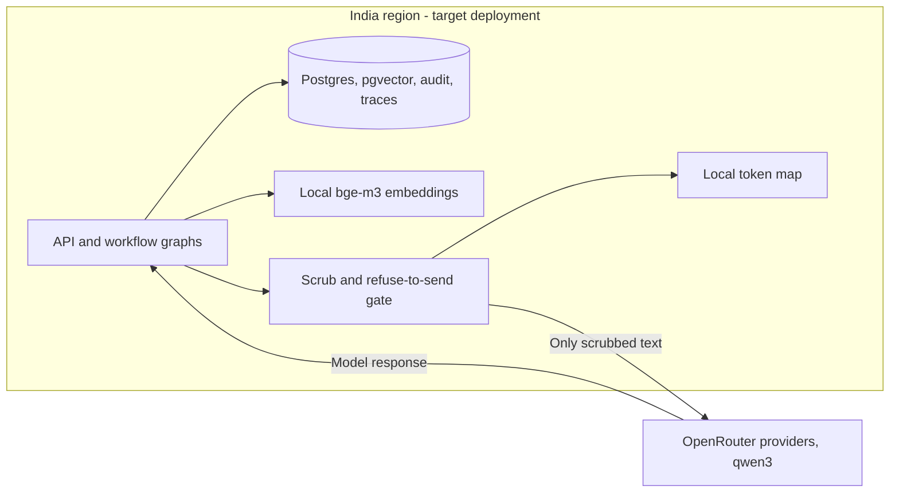

# D6: Deployment boundary

Path required by pack p.48. Status: Accepted · Date: 3 Nov 2026 · Decision: **hybrid**. Detail and evidence trail: [ADR-001](../docs/adr/ADR-001-hybrid-deployment.md).

## Context

Pack p.32 gives four options: on-premise, private cloud in an India region, public cloud with a public LLM, and hybrid. Gate 2 answers were not received, so the matrix is rescored with working assumptions A07 (vendor terms), A08 (SMS), A11 (audio) and the residency constraint (identified health data never leaves India). The assumptions are in [assumptions.md](../docs/assumptions.md).

Scores are the pod's, compared cell by cell with the pack's opening view (p.32). "(rescored)" appears only where the pod's score differs from the pack's, with the reason.

## Scores

Strong / Fair / Weak, with the reason in one line. The pack's opening view follows the table.

| Criterion | On-premise | Private cloud, India region | Public cloud + public LLM | Hybrid |
|---|---|---|---|---|
| Identified-data residency | Strong: all data stays on hospital hardware | Strong: stores and inference stay in an India region | Weak: identified prompts would reach the vendor | Strong: identified data stays in-region; holds only while the scrub gate holds, since A07 is unanswered |
| Access to current models | Weak: open-weight models on bought GPUs only | Fair: open-weight models on rented GPUs | Strong: current hosted models | Strong: current models through one adapter (qwen3 via OpenRouter) |
| Operations burden | Weak: the hospital runs every server and GPU | Fair: managed estate, inference still operated | Strong: little to run | Fair: in-region estate plus egress controls |
| Cost at 9,000 a day | Weak (rescored; pack Fair): high fixed procurement and GPU staffing that no saved costing shows paying back at this volume | Fair: recurring provisioned GPU cost | Fair: pay per call, so spend grows with volume | Fair: regional baseline plus variable LLM calls |
| Time to first value | Weak: hardware procurement comes first | Fair: provisioning needed, no hardware purchase | Strong: fastest to build | Fair: runs locally today, but India-region hosting is not done |
| Audit and control | Strong: the hospital controls every log | Strong: in-region logs under our control | Weak (rescored; pack Fair): identified prompts leave the boundary and vendor-side handling is unverified (A07) | Strong (on identified data): audit and traces stay in-region; the vendor sees only scrubbed text |

Pack opening view (p.32), for comparison:

| Criterion | On-premise | Private cloud, India | Public cloud + public LLM | Hybrid |
|---|---|---|---|---|
| Identified-data residency | Strong | Strong | Weak | Strong |
| Access to current models | Weak | Fair | Strong | Strong |
| Operations burden | Weak | Fair | Strong | Fair |
| Cost at 9,000 a day | Fair | Fair | Fair | Fair |
| Time to first value | Weak | Fair | Strong | Fair |
| Audit and control | Strong | Strong | Fair | Strong (on identified data) |

Two cells differ from the pack: on-premise cost (Weak, pack Fair) and public cloud audit and control (Weak, pack Fair). The other 22 cells match.

## Decision

Hybrid. Identified data, embeddings (local bge-m3), Postgres/pgvector, graph state, audit and traces stay in-region. Only text scrubbed by the egress gate goes to OpenRouter providers (qwen3). If anything survives the scrub, the call is refused rather than sent. Re-identification happens in-region.

## Evidence

- Decision record: [ADR-001](../docs/adr/ADR-001-hybrid-deployment.md).
- Egress code: `services/common/deid.py` (Presidio, Indian recognisers, refuse-to-send guard); model calls go through `services/agent/llm.py`.
- Local embeddings: `services/records/embed.py`.
- Tests: `services/agent/tests/test_deid.py` (zero-hit replay gate, refuse on surviving identifier, production transport, hedge restoration).
- Replay tool and saved runs: `tools/egress_replay.py`; [egress-20261103-010825](../evals/runs/egress-20261103-010825.md) and [egress-20261103-051910](../evals/runs/egress-20261103-051910.md) (200 synthetic payloads, zero hits). A finite synthetic replay does not prove complete de-identification.

## Switch triggers

1. The vendor will not commit to zero retention, or a regulator rules out cross-border inference on de-identified text: move to private cloud in an India region with self-hosted open-weight models.
2. Monthly LLM spend exceeds the fixed cost of an in-region GPU host: move to private cloud.
3. Any egress replay hit: the egress path stops (refuse-to-send) until fixed.

## Honest status

Runs locally via infra/docker-compose.yml today; India-region hosting, encryption at rest and restore drills are not done. Vendor zero-retention terms (A07) are unverified. See also [ADR-007](../docs/adr/ADR-007-scaling-and-load.md) for the scaling profile.
