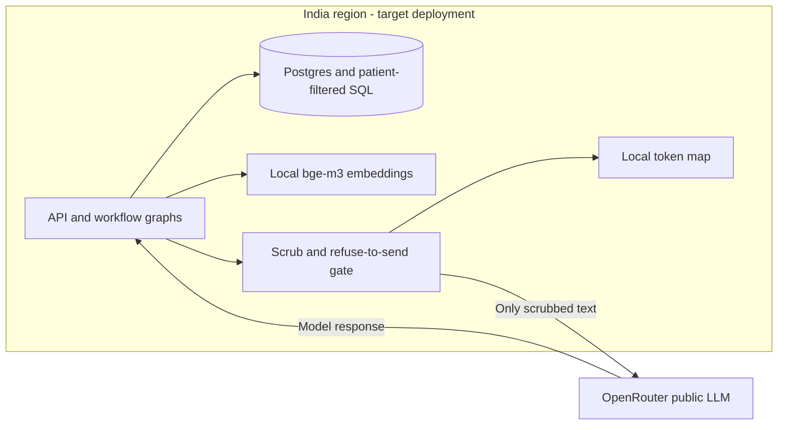

# D6: Deployment boundary

The decision is **hybrid**, following [ADR-001](../docs/adr/ADR-001-hybrid-deployment.md), the proposed decision record. Identified data belongs in an India region; only scrubbed text may cross the LLM boundary. This is the target architecture, not a claim that the local demo is hosted in India.

## Options

Scores: 1 = least favourable, 5 = most favourable. Operations scores reward lower burden; cost scores reward flexibility at Core scale, not a measured price estimate.

| Option | Identified-data residency | Access to current models | Operations burden | Cost shape |
| --- | --- | --- | --- | --- |
| On-premise, local models | 5: full local control | 2: constrained by purchased hardware | 1: hospital operates hardware and GPUs | 2: high fixed procurement and staffing |
| Private cloud, India region, local models | 5: regional stores and inference | 3: models depend on available GPUs | 3: managed infrastructure, inference still operated | 3: recurring provisioned GPU capacity |
| Public cloud + public LLM, identified prompts | 1: identified data reaches public vendor; rejected | 5: current hosted models | 5: low infrastructure burden | 4: usage based, grows with calls |
| Hybrid | 5: identified processing in-region, conditional on scrub boundary | 5: current models through adapter | 3: regional estate plus egress controls | 4: regional baseline plus variable LLM calls |

## Egress boundary

The token map stays local. No map, identified record store, or embedding service is sent to OpenRouter. ADR-001 also defines revisit triggers: degraded W3 draft quality, an India-region vendor endpoint with suitable terms, or identifiers found during replay. A replay leak must stop egress until fixed.

## Built today vs not yet

Built today: regex scrubbing for phone, email, ABHA and Aadhaar plus the refuse-to-send check in `services/agent/llm.py` (using `w1/guards.py`); local bge-m3 embeddings; patient filtering in retrieval SQL; per-workflow model routing. The API has a dev-only bearer stub gated by `SAHYOG_DEMO_AUTH=1`; OIDC replaces it at Pro. Docker Compose is a local deployment, with persistent database and Hugging Face cache volumes. Core serializes graph operations in one API process; it is not a scale-out configuration.

Not yet: Presidio recognisers in the model egress path, answer re-identification, India-region hosting, the 200-payload egress replay (D7), and a load test at 1,400 requests/hour (Elite tier, pack p.49). The ephemeral scrub token map exists today, but no re-identification pipeline does. ADR-001's Presidio/generalisation/re-identification design remains a target; regex scrubbing alone does not establish complete de-identification or residency compliance.
